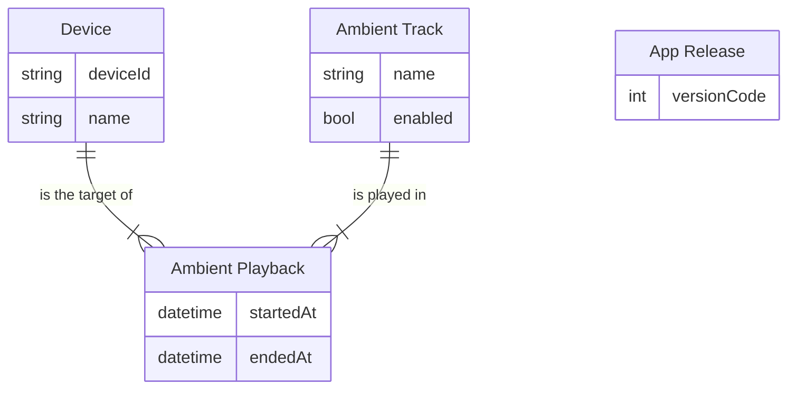

# Ambient sound: IntercomServer and IntercomClient

The ToiletAutomation device plays ambient sound while someone is in the toilet. The tracks are
kept and sent by IntercomServer. The toilet device is an intercom without the microphone side:
it uses the same audio protocol and the same discovery. IntercomServer gains:

- an API for the tracks;
- Keycloak sign-in;
- a player per device;
- an update channel for the app.

IntercomClient is a new Android app whose only feature is managing the tracks. The device itself
is in [high-level-design.md](high-level-design.md), and this design answers that document's
question of what sends the music.

Status: settled, 2026-11-22, with no open questions. It replaces the first draft of the same
day, which had a separate Python server (ToiletAutomationServer) and its own app. Built so far:
the track API, sign-in, the update channel and IntercomClient. The ambient player is next.

## 1. The decisions

1. **IntercomServer sends the ambient sound.** The audio protocol, the device discovery, the
   pacing, the deployment and the route to the LAN are already in production for these devices.
   A second service would repeat them.
2. **IntercomServer gets a test suite before its playback core changes.** It has none today, and
   the doorbell and the ChatGPT replies run on the code that changes. The suite pins today's
   behaviour first, then every new part comes with its tests (§3.3).
3. **Tracks are files on the server's data volume.** A track's name is its file name, and a
   disabled track sits in a `disabled` folder. There is no database and no S3. The operator's
   words: "I would stick to writing files to disk for now".
4. **Home Assistant starts and stops the sound through an "Ambient sound" switch per device, over
   MQTT.** The app and the tests use REST. Devices are addressed by the id they announce, never
   by their IP.
5. **A playback is one random enabled track, looped until it is stopped.** This follows the
   request's "a random track on repeat". Start is idempotent, stop fades out, and a cap ends a
   playback that is never stopped.
6. **FFmpeg decodes everything.** That covers what the phone records (AAC) and the built-in MP3
   sounds. It resamples to the format the device advertises and measures loudness. NLayer goes.
7. **IntercomClient is one screen: the track list and a record button.** It is Kotlin and Compose,
   and it signs in with AppAuth. It is not built ahead for an intercom client. The operator's
   words: "If I ever make it an intercom client, we'll review the design."
8. **IntercomServer serves the app's updates.** It uses MyDownloadsServer's two-call `/updates`
   contract, and Jenkins publishes each APK with a service account.
9. **IntercomClient is developed in the IntercomServer environment** (§4.7).
10. **The API is internal only, at `intercom.home`.** The phone has to be on the home network or
    the VPN to manage tracks or update the app. A public host is a question for the intercom
    client, if that design is ever reviewed.

## 2. System context

```
  IntercomClient --- HTTPS, Keycloak token ---> +--------------------+ ---> /data (CephFS):
     (phone)     <-- /updates: version, APK --- |   IntercomServer   |      tracks, APKs
  Jenkins ------- signed APK (service acct) --> |   .NET 9           |
                                                +--------------------+
                                                   |     |        ^
                                  UDP: seq + PCM   |     |        | MQTT
                                  +----------------+     |        v
                                  v                      v    Mosquitto <--> Home Assistant
                         [ ToiletAutomation ]      [ intercoms ]
```

A visit, end to end:

1. The PIR fires. The device publishes `motion` on.
2. HA's occupancy sensor goes on and holds for a few minutes after the last motion (the
   high-level design's presence section).
3. HA's automation turns on the device's Ambient sound switch.
4. IntercomServer picks a track and streams it to the device's `ip:port`.
5. Occupancy goes off. HA turns the switch off. The server fades out and stops, and the device
   plays out its buffer and goes quiet.

## 3. IntercomServer

### 3.1 What it is today

- **Runtime.** A .NET 9 generic host, driven by MQTT (MQTTnet). It discovers devices from their
  retained `configuration` topic.
- **Sounds.** The doorbell, ring and rejected sounds are MP3s built into the binary, decoded by
  NLayer and resampled with NAudio.
- **Playback.** One playback at a time across all devices, at a fixed 16 kHz, with one sequence
  counter shared by every device.
- **HTTP.** A hand-written `HttpListener` serving `/healthz` and `/readyz`.
- **Storage.** A CephFS data volume, holding the ChatGPT memories.
- **Tests.** None. IntercomTest is a Windows WPF client for driving devices by hand.

### 3.2 What changes

- **A web host.** The project moves to the Web SDK and the image to `dotnet/aspnet`. Health
  moves onto ASP.NET Core, and the API shares its port.
- **Sign-in.** JWT bearer validation against Keycloak realm `homelab`. The client roles from
  `resource_access` become role claims.
- **More than one kind of device.** The server reads devices from every prefix in
  `Devices:TopicPrefixes`, which are `intercom/client` and `toilet_automation`. A device
  publishes `capabilities` in its configuration, and they decide what the server sends it:
  - `intercom`: calls, ChatGPT conversations and the pick-up button;
  - `pa`: the doorbell and other broadcasts. Every firmware hard-codes it, with no setting. The
    doorbell reaches every `pa` device, and `Doorbell:ExtraDevices` goes.

  A device that publishes no `capabilities` keeps the microphone rule until its firmware
  publishes them. Under that rule, a device that advertises no `audio_formats.in` has no
  microphone and is never offered a call or a ChatGPT conversation, and the doorbell rings only on
  the devices that can take a call.
- **A player per device.** Each device gets its own playback, its own format (read from
  `audio_formats.out`, which today is read and ignored) and its own sequence counter. What the
  server already sends to a device (a ring, the doorbell, a ChatGPT reply) pauses that device's
  ambient sound, which resumes after it. A doorbell ring no longer cancels a playback on another
  device.
- **FFmpeg** decodes the built-in sounds and the tracks alike (§3.5).
- **Ambient tracks** on the data volume (§3.4), **the ambient player** (§3.5), **the HA switch**
  (§3.6), **the API** (§3.7) and **app releases** (§3.8).

### 3.3 The test suite

- **The project.** `IntercomServer.Tests` (xUnit) joins the solution. `kc project test` runs
  `cexec dotnet dotnet test IntercomServer.Tests/IntercomServer.Tests.csproj`, and Jenkins
  `Firmware/IntercomServer` gains a test stage before the image build.
- **FFmpeg for the tests.** `project.yaml`'s setup step installs it into the `dotnet` sidecar,
  through the passwordless `sudo` for apt that the toolchain images grant:

  ```yaml
  setup: >-
    cexec dotnet sh -c 'sudo apt-get update -qq && sudo apt-get install -y -qq ffmpeg'
    && cexec dotnet dotnet restore IntercomServer/IntercomServer.csproj
  ```

  The Jenkins test stage installs it into its container the same way.
- **Real systems, no fakes:**
  - an MQTTnet broker started in the test process (MQTTnet ships a server);
  - a UDP listener on localhost that receives what the server sends;
  - a temporary directory standing in for `/data`;
  - the real FFmpeg;
  - tokens signed by a key the tests make, with the server pointed at it as its issuer.
- **First, today's behaviour, pinned before it changes:**
  - device discovery from `configuration` and `state`;
  - packets: payload size, the counter, byte order;
  - pacing: the rate within a tolerance, making up a late chunk, the reset after a 60 ms stall;
  - loop and cancel;
  - which devices the doorbell reaches;
  - the call state machine's transitions.
- **Then each new part with its own tests:**
  - device kinds and prefixes;
  - the per-device player and its pausing;
  - decoding, resampling and loudness on real files (a phone's AAC recording, MP3, WAV);
  - the track store: its name rules, atomic writes, rename, enable, disable and delete;
  - the API, including its 401 and 403 answers;
  - the HA discovery and commands, through the broker;
  - the update channel.
- **Not covered:** the ChatGPT bridge's conversation with OpenAI, which needs the external API.

### 3.4 Tracks on disk

```
/data/ambient/enabled/Rain on the skylight.m4a
/data/ambient/disabled/Kids singing.m4a
/data/ambient/.incoming/            uploads in progress
/data/updates/57.apk
```

- **A name is the file name without its extension.** The extension is the uploaded file's
  format. Names are unique across both folders, ignoring case and extension. A name is 1 to 80
  characters, with none of `/ \ : * ? " < > |`, no control characters, and no leading or
  trailing space or dot.
- **Upload.** The file is written under `.incoming`, then probed with `ffprobe`. It must have an
  audio stream, last at most 15 minutes and be at most 50 MiB (52,428,800 bytes). Both limits are
  settings, and both are inclusive. The file is then renamed into `enabled/`, so a half-written
  upload is never a track.
- **Rename** is a rename in its folder. **Enable and disable** move the file between the folders.
  **Delete** removes it. All of them run under one lock.
- **Duration.** It comes from `ffprobe`, cached in memory by path and modification time.
- **A track that is playing keeps playing** when it is renamed, disabled or deleted. The player
  has its own decoded copy.
- **The volume.** It is the existing CephFS data volume. Check its size against the tracks: a
  three-minute recording is about 3 MB.

### 3.5 The ambient player

**Start** (the HA switch turned on, or the API):

1. The device must be known, online and advertising an endpoint. Otherwise the start is refused
   and the switch stays off.
2. If the device is already playing ambient sound, nothing happens.
3. The player picks at random among the enabled tracks. It skips the one it last played on this
   device, which it remembers in memory, unless that is the only one. With no enabled track the
   start is refused and logged.
4. One FFmpeg run decodes the track, mixes it down to mono and resamples it to the device's
   `audio_formats.out` at 16-bit. Its EBU R128 meter gives the track's loudness and peak. The
   whole track is decoded into memory: the worst case is 15 minutes at 48 kHz, 86 MB, and a
   typical recording is a few MB.
5. The sender applies the gain: the loudness target (−20 LUFS) minus the measured loudness, held
   down so the peak stays below −1 dBFS. It fades in over half a second, then loops the track.
   The sequence counter runs on across the seam, so the loop is gapless.

**Stop** (the switch turned off, the API, the cap, the device going offline, or shutdown). The
player fades out over half a second and ends. The device plays out its buffer and stops when it
runs dry.

**The wire.** The format is unchanged: a 4-byte big-endian sequence counter, then raw PCM.
Each 20 ms of audio to a device goes as equal packets of at most 1468 bytes: two of 960 at
48 kHz. The counter is now per device, and it runs on across playbacks while the server runs.

**Pacing.** This is today's `AudioStreaming`: 20 ms chunks timed against a stopwatch started
with the stream, and a reset after a stall of more than 60 ms. One thing is added: the first
500 ms (the prebuffer) go out ahead of real time, spread over about 100 ms. The device's buffer
is then full at once, and the server stays that far ahead.

**The cap.** A playback ends after 30 minutes (a setting), so a stuck sensor or a lost "off"
cannot play all night. It also bounds clock drift between the server and the device: 50 ppm over
30 minutes is 90 ms, well inside the buffer.

**A device that changes.** One that goes offline stops its playback. One that re-advertises
with a new IP gets the next packet at the new address.

**Server restart.** Playbacks are not resumed, and every switch is published off at startup. The
visit in progress loses its sound, and the next occupancy change starts it again.

### 3.6 Home Assistant, over MQTT

**What the server reads** under each prefix in `Devices:TopicPrefixes`:

- `<prefix>/<device_id>/configuration`, retained. It holds `unique_id`, `device`, `endpoint`
  (`ip:port`), `audio_formats` and `capabilities` (§3.2). An empty payload removes the device.
- `<prefix>/<device_id>/state`, from which the server reads `online`, and `enabled` for an
  intercom.

**What it publishes** for each device that advertises `audio_formats.out`, the intercoms included.
There is no speaker capability, and `Ambient:TopicPrefixes` goes.

- **Discovery**, retained: a switch "Ambient sound", and a sensor "Ambient track" holding the
  name of what is playing, empty when nothing is. Both carry `device.identifiers` set to the
  configuration's `unique_id`, so both show on that device's own page in HA. On the toilet, that
  is the identifier esp-mqtt-support gives the device.
- **State**: `intercom/server/devices/<device_id>/state`, retained, for example
  `{"ambient": "ON", "track": "Rain on the skylight"}`.
- **Commands**: `intercom/server/devices/<device_id>/set/ambient`, with `ON` or `OFF`. A
  retained command is ignored, so a stale `ON` cannot start sound after a restart.
- **Availability.** The switch is available while both the server and the device are up. For
  the server that is `intercom/server/status`, `online` or `offline` through an MQTT last will,
  which is new: the server has none today. For the device it is `online` in its state.

**The HA automation** builds on the occupancy sensor of the high-level design's presence
section. The entity ids depend on the device's name:

```yaml
alias: Toilet ambient sound
triggers:
  - trigger: state
    entity_id: binary_sensor.toilet_occupancy
    to: ["on", "off"]
actions:
  - action: "switch.turn_{{ trigger.to_state.state }}"
    target:
      entity_id: switch.toilet_ambient_sound
```

### 3.7 API

The paths are under `/api` unless shown otherwise. Bodies are JSON, except the uploads, which are
multipart. Every `/api` call needs a Keycloak bearer token: the app's calls need the client role
`user`, and publishing needs `pipeline`. A track is named by its name, URL-encoded, and a device
by its device id.

| Method | Path | Caller | What |
|---|---|---|---|
| GET | `/api/ambient-tracks` | app | name, enabled, duration; sorted by name |
| POST | `/api/ambient-tracks` | app | upload: a form of `name`, then `file`; 201 with the track |
| PATCH | `/api/ambient-tracks/{name}` | app | `name`, `enabled`, or both; 200 with the track |
| DELETE | `/api/ambient-tracks/{name}` | app | 204 |
| GET | `/api/ambient-tracks/{name}/audio` | app | the file; `Range` gives 206 |
| GET | `/api/devices` | tests, by hand | devices: kind, online, format, what is playing |
| PUT | `/api/devices/{device_id}/ambient` | tests, by hand | start; an optional `track`, random without one |
| DELETE | `/api/devices/{device_id}/ambient` | tests, by hand | stop |
| POST | `/api/app-releases` | Jenkins | `apk`, `version_code`; 409 for a version already there |
| GET | `/updates?action=version` | app, no auth | the highest version code as text, or an empty body |
| GET | `/updates?action=download` | app, no auth | that APK |

A track is answered as `{"name":"Rain on the skylight","enabled":true,"duration":134.2}`. The
`duration` is its length in seconds, as a JSON number.

The errors:

- 400 for a file that is not audio, a name that breaks the rules, a change that is not a JSON
  object of `name`, `enabled` or both, or an upload whose parts are not `name`, then `file`: any
  other order answers "An upload is a multipart form of name, then file.";
- 401 and 403 for a missing token or role;
- 404 for an unknown track or device;
- 409 for a name already taken, a start with no enabled track, or an offline device;
- 413 for a file too long or too large.

`/updates` stays unauthenticated, as in MyDownloadsServer, so a build whose sign-in is broken can
still update itself out of the problem.

### 3.8 App releases

- **Publish.** `POST /api/app-releases` writes the APK to `/data/updates/<version_code>.apk`, by
  a temporary file and a rename. A version code that is already there gets a 409. The newest
  three are kept and older ones deleted. The route takes a request of at most 128 MiB.
- **Serve.** `/updates?action=version` answers the highest version code, and `action=download`
  serves that file.

### 3.9 Settings

- `HTTP_PORT` (8080), the web host's port, and `DATA_DIR` (`data`), which holds the tracks under
  `ambient/` and the app releases under `updates/`.
- `Devices:TopicPrefixes` (§3.2, §3.6).
- The loudness target (−20 LUFS), the fades (0.5 s), the prebuffer (500 ms) and the cap
  (30 min).
- The upload limits: `TRACK_MAX_SECONDS` (900) and `TRACK_MAX_BYTES` (52,428,800, 50 MiB).
- The Keycloak issuer and audience: `KEYCLOAK_ISSUER` is required and must be an HTTPS URL, and
  `KEYCLOAK_AUDIENCE` is `intercom-server` unless set.

### 3.10 Deployment, in IntercomDeploy

- **The image** is `dotnet/aspnet:9.0` with `ffmpeg` from apt.
- **The HTTP route.** There is no Kubernetes Ingress. IntercomDeploy's ClusterIP Service
  `intercom-http` publishes the server's port on 80, and the shared nginx serves it from the
  Service's annotations as `intercom.home`, internal, with a step-ca certificate (decision 10).
- **Keycloak.** IntercomDeploy's Terraform already declares the Keycloak provider. It takes
  IotDeploy's `keycloak-client` module and three clients:
  - `intercom-server` holds the client roles `user` and `pipeline`, and is the audience the
    server checks. It has no login flow of its own.
  - `intercom-client` is the app's client: public, standard flow with PKCE, redirect
    `org.webathome.intercom:/oauth2redirect`. An audience mapper adds `intercom-server` to its
    tokens.
  - `intercom-pipeline` is a service account with `intercom-server`'s `pipeline` role, for
    Jenkins.

  The operator's account gets `intercom-server`'s `user` role.
- **The data volume** is the existing one.
- **UDP** is unchanged. The server sends outbound to the LAN, and the LoadBalancer keeps taking
  the intercoms' microphone audio.
- **MQTT.** The server's `intercom` user now reads `toilet_automation/#` and writes
  `homeassistant/#`. If Mosquitto restricts users by topic, its rules have to allow that.

## 4. IntercomClient

### 4.1 What comes from MyDownloadsClient

MyDownloadsClient gives three things:

- **The Jenkinsfile.** It runs in the `android-35` container, takes the versionCode from the
  build number, and signs with `apksigner` using a password from OpenBao.
- **The `/updates` contract.**
- **`.kubecoder/project.yaml`** on the `android` toolchain.

Its code is not taken. It is 2014 Java (`AsyncTask`, `android.preference`), it signs in with a
username and password rather than Keycloak, and it has no media code.

### 4.2 Stack

- Kotlin, and Jetpack Compose with Material 3, in one activity with one ViewModel.
- OkHttp and kotlinx.serialization for the API.
- Media3 ExoPlayer for playback, MediaRecorder for recording, and AppAuth for sign-in.
- minSdk 26 and targetSdk 35.
- The application id is `org.webathome.intercom`.
- **The step-ca root.** `intercom.home` has a step-ca certificate, and Android ignores
  user-installed CAs. So the app bundles the step-ca root, and its network security config
  trusts it for `intercom.home` only. Keycloak keeps its public certificate.

### 4.3 The screen

- **The list.** Each track shows its name and duration, and a disabled track is greyed and
  marked. A tap plays it on the phone and a second tap pauses it; the row that is playing shows
  its progress. A row's menu has Rename, Disable/Enable and Delete, and Delete asks for
  confirmation. A pull refreshes the list.
- **The record button.** It opens a panel on the same screen with the elapsed time, a level
  meter and Stop. After stop you can play the take back, name it (default "Recording 22 Nov
  14:03"), then upload or discard it. Upload shows progress, and the track appears in the list.
  Recording stops by itself at 15 minutes.
- **The overflow menu.** Check for updates, Sign out, and the app version.
- **First start.** Sign-in comes before the list.

**Not in it:** importing files, playing on a device, and anything to do with calls.

**Playback.** ExoPlayer streams `/api/ambient-tracks/{name}/audio` through an OkHttp data source
that adds the bearer token.

**Recording.** MediaRecorder records AAC-LC in MP4: mono, 48 kHz, 128 kbit/s. The microphone
permission is asked on the first recording.

### 4.4 Sign-in

- **The flow.** AppAuth runs the authorization code flow with PKCE against realm `homelab` and
  client `intercom-client`, in a Custom Tab.
- **Staying signed in.** It asks for `offline_access`. Keycloak's ordinary refresh token dies
  with the SSO session after about half an hour idle, and without it an app opened now and then
  would ask for a sign-in every time.
- **Tokens.** The AuthState is kept in app-private storage. A failed refresh, or Sign out,
  returns to the sign-in screen.

### 4.5 Updates

- **The check.** On start, in release builds only, the app calls `GET /updates?action=version`
  with a 2-second timeout. A failure is ignored.
- **The prompt.** If the answer is higher than the installed versionCode, a dialog offers the
  update.
- **The install.** The app downloads the APK to its cache directory and installs it through the
  PackageInstaller session API. MyDownloadsClient's `ACTION_INSTALL_PACKAGE` has been deprecated
  since API 29. The system still asks the user to confirm, and the app needs
  `REQUEST_INSTALL_PACKAGES`.

### 4.6 Build and release

- **Versioning.** versionCode and versionName are the Jenkins build number.
- **The Jenkins job `Firmware/IntercomClient`,** beside `Firmware/IntercomServer`:
  1. builds with `./gradlew assembleRelease`;
  2. signs with `apksigner`, using a new keystore kept the way MyDownloadsClient keeps its own:
     the `.jks` in the repo, its password in OpenBao;
  3. publishes: it gets a client-credentials token for `intercom-pipeline`, whose secret is also
     in OpenBao, and posts the APK to `/api/app-releases`.
- **In KubeCoder.** `kc project build` runs `cexec android ./gradlew assembleRelease`, and
  `kc project test` runs the JVM unit tests (the ViewModel, the update check, the API client).
  The environment has no emulator, so the operator checks the screen on the phone.

### 4.7 The environment

IntercomClient is developed in the IntercomServer environment. IntercomServer's
`.kubecoder/config.yaml` gains `repos: [IntercomClient]` and the `android` toolchain, and its
`project.yaml` gains the FFmpeg setup (§3.3). IntercomClient's own `project.yaml` carries its
build and test verbs. An agent then changes the API and its client in one session.

The one price is memory: the `android` sidecar's 5 GiB limit counts on the node whenever the
environment runs, server-only sessions included.

## 5. Data model

### Scope

What IntercomServer keeps for ambient sound and the app: the tracks, the devices it plays to,
the playbacks, and the app releases. This is a concept model, so cardinalities are maxima only.

### Entities

*Ambient Track.* An Ambient Track is an individual sound file IntercomServer keeps to play on
repeat on a device. This includes a disabled track, which stays listed but is never picked.
Samples: "Rain on the skylight" (2:14, recorded on the phone); "Kids singing" (0:48, disabled);
"Ocean" (12:30). Notes: an Ambient Track is identified by its name, which is its file name, so a
rename changes the identifier. Delete removes it for good, and disabling is how a track is kept
out of the rotation. It is not one of the built-in sounds (the doorbell, the ring), which are
part of the server. Its facts: name, enabled, duration, format. Also called: track, ambient
sound track, recording.

*Device.* A Device is an individual unit IntercomServer sends audio to, identified by the device
id in its MQTT topics, as it last advertised itself: an intercom or a ToiletAutomation unit. This
includes a unit that is offline. Samples: the toilet; the front-door intercom; the bench board.
Notes: the server learns Devices from MQTT, and nobody creates one in the app. Its capabilities
decide what the server sends it (§3.2). A Device that publishes none falls under the microphone
rule. Its facts: name, topic prefix, endpoint, output format, capabilities, whether it has a
microphone, online.

*Ambient Playback.* An Ambient Playback is an individual run of one Ambient Track, on repeat, on
one Device, from a start to a stop. Samples: "Rain on the skylight" on the toilet from 07:12 to
07:16, stopped by HA; "Ocean" from 07:40 to 08:10, stopped by the cap; one playing now, with no
end yet. Notes: it plays one track throughout. A start while one is playing does not make a new
one. A ring or a ChatGPT reply that pauses it does not end it.

*App Release.* An App Release is an individual signed build of IntercomClient the server offers
for update, identified by its version code. Samples: 3, 4, 7 (Jenkins build numbers have gaps).
Notes: the one offered is the highest version code, and a version code is published once.

### Diagram



### Assertions

1. Each Device is the target of one or more Ambient Playbacks.
2. Each Ambient Playback is played on one Device, also over time.
3. Each Ambient Track is played in one or more Ambient Playbacks.
4. Each Ambient Playback plays one Ambient Track, also over time: it never switches track.
5. A Device has at most one Ambient Playback without an end at any moment.
6. An Ambient Playback started without a chosen Ambient Track plays an enabled Ambient Track.
   That track is not the one the Device's previous Ambient Playback played, unless it is the
   only enabled Ambient Track.
7. No two Ambient Tracks share a name, ignoring case.
8. No two App Releases share a version code. The app is offered the App Release with the highest
   version code.

### Sample instances

| Ambient Track | duration | enabled |
|---|---|---|
| Rain on the skylight | 2:14 | yes |
| Kids singing | 0:48 | no |
| Ocean | 12:30 | yes |
| Birds | 1:05 | yes |

| Device | topic prefix | format | capabilities | microphone | online |
|---|---|---|---|---|---|
| Toilet | `toilet_automation` | mono 48 kHz 16-bit | `pa` | no | yes |
| Front-door intercom | `intercom/client` | mono 16 kHz 16-bit | none: the microphone rule | yes | yes |
| Bench board | `toilet_automation` | mono 48 kHz 16-bit | `pa` | no | no |

| Ambient Playback | Device | Ambient Track | started | ended |
|---|---|---|---|---|
| 1 | Toilet | Rain on the skylight | 07:12 | 07:16 |
| 2 | Toilet | Ocean | 07:40 | 08:10, the cap |
| 3 | Bench board | Birds | 09:00 | 09:02 |
| 4 | Toilet | Rain on the skylight | 10:30 | none: playing |

| App Release | published |
|---|---|
| 3 | 2026-12-01 |
| 4 | 2026-12-03 |
| 7 | 2026-12-10, offered |

### Decisions and open questions

Decisions:

- **An Ambient Playback is not kept after it ends.** The one exception is each Device's latest,
  remembered in memory for the next pick (assertion 6), and a restart forgets it. The operator's
  words: "I don't see this gaining a lot of additional storage or data requirements."
- **Nothing is stored for a Device.** Its retained MQTT messages are its record, and they are
  current state only.
- **An Ambient Track's name and enabled flag are current state only.** A rename leaves no trace
  of the old name.

Open questions: none.

## 6. Testing

| Layer | What it proves | How |
|---|---|---|
| IntercomServer suite | today's behaviour, then the tracks, the player, the HA switch, the API and the update channel | xUnit against an in-process MQTT broker, a localhost UDP listener, a temporary data directory and the real FFmpeg (§3.3) |
| IntercomClient | the ViewModel, the update check, the API client | JVM unit tests |
| End to end | the stream arrives clean and sounds right | production IntercomServer sends to the bench board or the toilet; the firmware's audio counters (packets, gaps filled, underruns) show the stream; the operator listens |

## 7. Order of work

1. **The test suite** for today's behaviour, and the Jenkins test stage.
2. **The core rework:**
   - per-device playback, formats and counters;
   - FFmpeg for the built-in sounds;
   - device kinds and prefixes.

   The intercoms are checked by the operator after the deploy.
3. **The web host and sign-in:** ASP.NET Core, JWT, the ingress and the Keycloak clients.
4. **Tracks and the update channel:** the store, the API and app releases.
5. **IntercomClient:**
   - sign-in, the list and playing on the phone;
   - rename, disable and delete;
   - record and upload;
   - updates and the release pipeline, then the first install from Jenkins.
6. **The ambient player and the HA switch,** tested against the suite's UDP listener.
7. **End to end** on the bench board, once the firmware's esp-audio-support plays. Then the HA
   automations on the real device.
