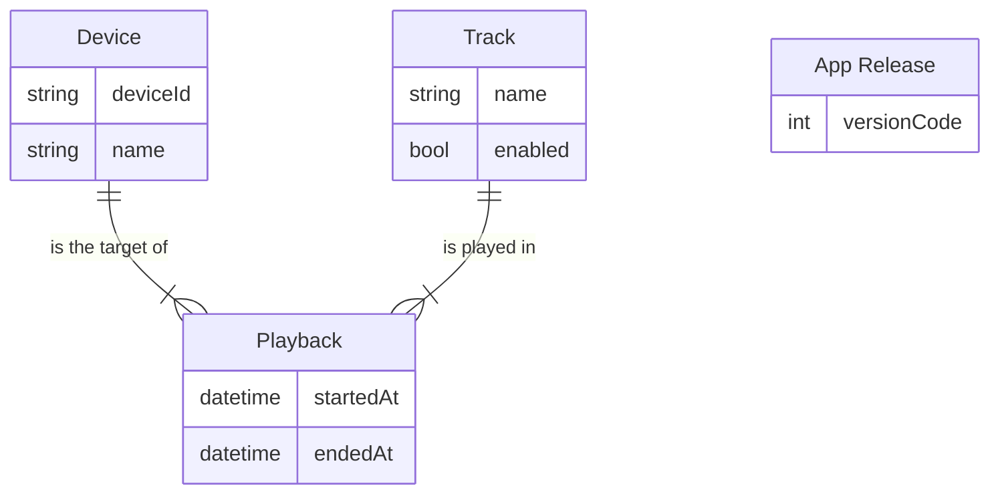

# ToiletAutomation: app and server design

The Android app and the server behind it. The server keeps the tracks in S3, serves the app, and
streams a track to the device when Home Assistant asks it to. The device itself is in
[high-level-design.md](high-level-design.md), and this design is the answer to that document's
first open question: what sends the music.

Status: first draft, 2026-11-22. Nothing is built yet.

## 1. The decisions

1. **Two new repos and a deploy repo.** These are `pvginkel/ToiletAutomationServer`,
   `pvginkel/ToiletAutomationClient` (the Android app) and `pvginkel/ToiletAutomationDeploy`.
   The names follow MyDownloadsServer/MyDownloadsClient and IntercomServer/IntercomDeploy.
2. **The server is a backend-only modern app: Python, generated from ModernAppTemplate.** §3
   gives the reasons.
3. **Home Assistant drives playback over MQTT, not HTTP.** For each device, the server publishes
   a `switch` through HA discovery, and an HA automation turns it on and off on occupancy. The
   server learns each device's endpoint and audio format from the device's own retained MQTT
   configuration, the way IntercomServer learns the intercoms'. HA needs no token and no
   integration. All the control stays in HA, and the device and the server never talk about
   presence.
4. **A playback is one random enabled track, looped until it is stopped.** Start is idempotent.
   Stop fades out. A cap ends a playback that is never told to stop.
5. **The server stores what was uploaded, and converts it at play time.** S3 holds the file as
   the app sent it. The player decodes it into the format the device advertises, applies a gain
   measured at upload so all tracks play at the same loudness, and paces it out over UDP.
6. **The app is new code in Kotlin and Compose.** MyDownloadsClient gives it its release
   pipeline, its update contract and its environment setup, but not its code (§5.1).
7. **The app signs in to Keycloak itself, with AppAuth.** It uses the authorization code flow
   with PKCE, and the server validates the bearer token.
8. **The server hosts the app's update channel.** It uses MyDownloadsServer's two-call `/updates`
   contract, and Jenkins publishes each signed APK to the server.

## 2. System context

```
  Android app --- HTTPS, Keycloak token ---> +--------------------------+ ---> S3 (Ceph RGW):
              <-- /updates: version, APK --- |  ToiletAutomationServer  |      uploads, APKs
  Jenkins ------ signed APK (service acct) ->|  Python, one process     | ---> PostgreSQL: tracks,
                                             +--------------------------+      devices, playbacks
                                                 |                  ^
                                  UDP: seq + PCM |                  | MQTT
                                                 v                  v
                                       [ ToiletAutomation ] <-> Mosquitto <-> Home Assistant
                                          the device       MQTT
```

A visit, end to end:

1. The PIR fires. The device publishes occupancy `on`.
2. HA's automation turns on the device's Music switch.
3. The server gets the command. It picks a track and streams it to the device's `ip:port`.
4. Occupancy goes `off`. HA turns the switch off. The server fades out and stops, and the device
   plays out its buffer and goes quiet.

## 3. Server technology: Python on ModernAppTemplate

The server is generated from ModernAppTemplate with `use_frontend=false`, a database, OIDC and
S3, and no server-sent events. SonosController is the precedent: it is a backend-only app with
long-lived threads in the process.

**The Java plumbing is not where it was expected.** MyDownloadsServer has no S3, no database and
no bearer-token validation. It takes HTTP Basic credentials and checks the password against
Keycloak with the password grant. Its update channel serves the APKs baked into its Docker image,
one app per server. What carries over from it is the deploy pattern: Jenkins, kaniko, a version
pin in the deploy repo, then Argo CD. The template has that too.

**What the template gives:**

- Bearer JWT validation against Keycloak's keys, with roles. Service-account callers get a role
  of their own, the way IoT Support's Jenkins upload uses its `pipeline` role.
- S3 through boto3, and PostgreSQL with Alembic, each with its readiness check.
- One process (Waitress, 50 threads) and one replica with the `Recreate` strategy. A permanent
  background thread has a sanctioned pattern: a singleton service started in the background, and
  stopped by the lifecycle's shutdown events. The player needs exactly that.
- Tests against real PostgreSQL and S3 (the KubeCoder `postgres` and `s3storage` services), and
  the Jenkins test stage.
- The deploy repo's Terraform modules for the database, the S3 user and the Keycloak clients.
- The modern-app guide, which every agent writing the code follows.

**What it lacks, built here:**

- **MQTT.** Copy IoT Support's `mqtt_service.py`: paho, MQTT v5, reconnect and metrics.
- **Audio decoding.** PyAV, whose wheels bundle FFmpeg, so the shared runtime image is left as
  it is. Numpy holds the samples, and pyloudnorm measures loudness (EBU R128).
- **S3 streaming with `Range`.** The template's `S3Service` returns whole files in memory.
- **The paced UDP sender.** Ported from IntercomServer (§4.3).

**Python keeps up.** The stream is about 68 datagrams a second (48 kHz mono 16-bit, 1468 bytes
of PCM each). A Python thread on a monotonic clock sends that with millisecond jitter, and the
device's half-second buffer absorbs far more. A socket send releases the GIL.

**The alternatives:**

- **Java (Spring Boot).** Spring's resource server and the AWS SDK make auth and S3 quick. But
  everything else in the list above would be written again, outside the guide, and
  MyDownloadsServer gives only the Dockerfile and Jenkinsfile shape.
- **.NET, extending IntercomServer.** Its sender ports well, but it has no HTTP API, no storage
  and no auth. It is hard-wired to 16 kHz and to one playback for all devices, and extending it
  ties the toilet's music to the intercoms' releases.

## 4. Server

### 4.1 Services

| Service | What it does |
|---|---|
| `TrackService` | Tracks: upload and its checks, rename, enable, delete, the audio object in S3 |
| `TrackAnalysisService` | Measures a new track's loudness and peak, on a background thread |
| `DeviceService` | Devices, from their MQTT configuration and state |
| `PlayerService` | Playbacks: start, stop, the cap; one sender thread per playing device |
| `HomeAssistantService` | The Music switch and Track sensor per device: discovery, commands, state |
| `MqttService` | The broker connection, copied from IoT Support |
| `AppReleaseService` | APK publishing, and `/updates` |

### 4.2 Tracks

- **Upload.** The app posts the file and a name. The server opens the file with PyAV and refuses
  it unless it has an audio stream, lasts at most 15 minutes and is at most 50 MB (both are
  settings). It stores the bytes in S3 under `tracks/<id>`, records the name, duration, size and
  content type, and enables the track.
- **Analysis.** After the upload, a background thread measures the track's integrated loudness
  and its peak. That takes seconds for a long track, so the upload answers at once. Until the
  measurement is in, the track plays without gain.
- **Rename and enable.** Both overwrite the value. Nothing keeps past names.
- **Delete.** It removes the track, its audio object and its past playbacks. A track that is
  playing keeps playing: the player has its own decoded copy, and the playback ends as usual.
  Disabling is the way to keep a track out of the rotation without losing it.
- **Disabled tracks.** They stay listed and playable in the app, but the player never picks them.

### 4.3 The player

**Start** (the HA switch turned on, or the API):

1. The device must be known, online and advertising an endpoint. Otherwise the start is refused
   and the switch stays off.
2. If the device is already playing, nothing happens.
3. The player picks at random among the enabled tracks. It skips the track this device played
   last, unless that is the only one. With no enabled track, the start is refused and logged.
4. It downloads the track from S3 and decodes it with PyAV. It resamples to the device's
   advertised format (mono, its sample rate, 16-bit) and applies the gain: the loudness target
   minus the measured loudness, held down so the peak stays below −1 dBFS. The whole track is
   decoded into memory. The worst case is 15 minutes at 48 kHz, 86 MB, and a typical recording
   is a few MB.
5. It fades in over half a second, then loops the decoded track. The sequence counter runs on
   across the seam, so the loop is gapless.

**Stop** (the switch turned off, the API, the cap, the device going offline, or shutdown). The
player fades out over half a second, sends that, and ends the playback. The device plays out its
buffer and stops when it runs dry, which is the end-of-stream rule in the high-level design's
audio section.

**The wire.** This is the high-level design's format: a 4-byte big-endian sequence counter, then
raw PCM. Payloads are 1468 bytes, which is whole samples and within the 1472-byte datagram limit.
The counter is per device and runs on across playbacks while the server runs. IntercomServer's
counter is shared by all devices, and that part is not copied.

**Pacing.** This is ported from IntercomServer's `AudioStreaming`. The player sends 20 ms chunks
timed against a monotonic clock started with the stream, so a late wake-up is made up on the
next chunk. After a stall of more than 60 ms the clock resets instead of bursting. One thing is
added: the first 500 ms (the prebuffer, a setting) go out ahead of real time, spread over about
100 ms. The device's buffer is then full at once, and the server stays that far ahead for the
rest of the stream.

**Clock drift.** The server's clock and the device's I2S clock differ by tens of ppm, a few
milliseconds a minute. The cap bounds that: 50 ppm over 30 minutes is 90 ms, well inside the
buffer.

**The cap.** A playback ends after 30 minutes (a setting), so a stuck occupancy sensor or a lost
"off" cannot play music all night.

**A device that changes.** A device that goes offline stops its playback. A device that
re-advertises with a new IP gets the next datagram at the new address.

**Server restart.** Playbacks are not resumed. At startup the server ends the playbacks the last
run left open and publishes every switch off. The visit in progress loses its music, and the next
occupancy change starts it again.

**Volume.** The server normalises loudness between tracks to a target (−20 LUFS, a setting tuned
by ear). The listening level stays the device's volume setting, as the high-level design has it.

### 4.4 Home Assistant, over MQTT

**What the server reads from the device.** The device publishes these in Intercom's shape, with
the topic prefix `toilet_automation`:

- `toilet_automation/<device_id>/configuration`, retained. It holds `unique_id`, `device`,
  `endpoint` (`ip:port`) and `audio_formats.out` (`channel_layout`, `sample_rate`, `bit_rate`). An
  empty payload removes the device.
- `toilet_automation/<device_id>/state`. The server reads `online` from it.

**What the server publishes, per device:**

- **Discovery**, retained: a switch "Music" and a sensor "Track" (the name of what is playing,
  empty when nothing is). Both carry `device.identifiers` set to the configuration's `unique_id`,
  which is the identifier esp-mqtt-support gives the device. So they show on the toilet's own
  device page in HA, beside occupancy and the fan.
- **State**: `toilet_automation_server/<device_id>/state`, retained, for example
  `{"music": "ON", "track": "Rain on the skylight"}`.
- **Commands**: `toilet_automation_server/<device_id>/set/music`, with `ON` or `OFF`. The server
  ignores a retained command, so a stale `ON` can never start music after a restart.
- **Availability.** The switch is available only while both are up: the server
  (`toilet_automation_server/status`, `online` or `offline` through an MQTT last will) and the
  device (`online` in its state).

**The HA side** is one automation. The entity ids depend on the device's name:

```yaml
alias: Toilet music
triggers:
  - trigger: state
    entity_id: binary_sensor.toilet_occupancy
    to: ["on", "off"]
actions:
  - action: "switch.turn_{{ trigger.to_state.state }}"
    target:
      entity_id: switch.toilet_music
```

### 4.5 API

The paths are under `/api` unless shown otherwise. Bodies are JSON, except the uploads, which are
multipart. Every `/api` call needs a Keycloak bearer token: the app's calls need the client role `user`,
and publishing needs `pipeline`. Paths name resources by their surrogate key.

| Method | Path | Caller | What |
|---|---|---|---|
| GET | `/api/tracks` | app | id, name, enabled, duration, last played; the template's paged list, by name |
| POST | `/api/tracks` | app | upload: `file`, `name`; 201 with the track |
| PATCH | `/api/tracks/{id}` | app | `name`, `enabled` |
| DELETE | `/api/tracks/{id}` | app | 204 |
| GET | `/api/tracks/{id}/audio` | app | the uploaded file, streamed from S3; `Range` gives 206 |
| GET | `/api/devices` | app | devices: online, format, what is playing |
| PUT | `/api/devices/{id}/playback` | app, tests | start; an optional `track_id`, random without one |
| DELETE | `/api/devices/{id}/playback` | app, tests | stop |
| POST | `/api/app-releases` | Jenkins | `apk`, `version_code`; 409 for a version already published |
| GET | `/updates?action=version` | app, no auth | the highest version code as text, or an empty body |
| GET | `/updates?action=download` | app, no auth | that APK |

`/updates` stays unauthenticated, as in MyDownloadsServer. A build whose sign-in is broken can
still update itself out of the problem.

The errors are the template's exceptions:

- 400 for a file that is not audio;
- 413 for one too long or too large;
- 404 for an unknown track or device;
- 409 for a start with no enabled track or an offline device.

### 4.6 Settings and readiness

- **Settings:**
  - the MQTT URL and credentials, and the device topic prefix (`toilet_automation`);
  - the loudness target (−20 LUFS) and the fades (0.5 s);
  - the prebuffer (500 ms) and the playback cap (30 min);
  - the upload limits (15 min, 50 MB).
- **Readiness.** PostgreSQL and S3 are critical, as the template has them. MQTT is not critical:
  the app can manage tracks without it.

### 4.7 Deployment

- **The deploy repo.** `ToiletAutomationDeploy` holds the template's chart, `config/prd/values.yaml`
  and Terraform. The Terraform creates the database, an S3 user and bucket on Ceph RGW, and three
  Keycloak clients in realm `homelab`:
  - `toiletautomation`: the backend's own confidential client. The template requires one, and its
    cookie login goes unused.
  - `toiletautomation-android`: a public client with the standard flow and PKCE, and redirect
    `org.webathome.toiletautomation:/oauth2redirect`. An audience mapper adds `toiletautomation`
    to its tokens, so the server accepts them.
  - `toiletautomation-pipeline`: a service account with the `pipeline` role, for Jenkins. IotDeploy's
    `iotsupport-pipeline` is the example.
- **One replica, `Recreate`.** These are the template's defaults, and they are required: the
  player lives in the process.
- **Host.** `toilet-automation.home`, internal, with a step-ca certificate, as SonosController
  has it (Q4).
- **UDP to the device.** The pod sends outbound to the LAN, the way IntercomServer sends to the
  intercoms. No Service is needed, since the device never sends back.
- **MQTT.** Mosquitto in `mosquitto-prd`. The credentials come through ExternalSecrets from
  OpenBao.
- **Jenkins.** The job `ToiletAutomationServer` runs the template's Jenkinsfile: tests, kaniko,
  a version pin into the deploy repo, then Argo CD.

## 5. Android app

### 5.1 What comes from MyDownloadsClient

**MyDownloadsClient does not sign in to Keycloak.** It sends HTTP Basic credentials, and
MyDownloadsServer checks the password against Keycloak. Its code is 2014 Java (`AsyncTask`,
`android.preference`, `HttpURLConnection`), with no media code at all.

**What is taken:**

- **The Jenkinsfile.** It runs in the `android-35` container, takes the versionCode from the
  build number, and runs `apksigner` with the keystore password from OpenBao.
- **The `/updates` contract** and the install through a FileProvider.
- **`.kubecoder/project.yaml`** on the `android` toolchain.
- **The `org.webathome.*` application id.**

**The app code is not taken.** ScanToPdfClient was made by copying MyDownloadsClient and
deleting. Doing that here would keep the deprecated APIs and leave none of the features, so the
app is written new.

### 5.2 Stack

- Kotlin, and Jetpack Compose with Material 3, in one activity.
- ViewModels with coroutines and StateFlow.
- OkHttp and kotlinx.serialization for the API.
- Media3 ExoPlayer for playback, MediaRecorder for recording, and AppAuth for sign-in.
- minSdk 26 and targetSdk 35.
- No DI framework, since the app is small.

### 5.3 Screens

- **Tracks.** The list shows each track's name and duration, with disabled tracks greyed and
  marked. A tap plays the track on the phone, with a player bar at the bottom (play/pause and
  position). A row's menu has Rename, Disable/Enable and Delete; Delete asks for confirmation.
  The list refreshes on a pull, and a Record button opens the recorder.
- **Record.** It has record/stop, the elapsed time and a level meter. After stop you can play
  the take back, name it (default "Recording 22 Nov 14:03"), then upload or discard it. Upload
  shows progress and returns to the list. Recording stops by itself at the server's maximum
  length.
- **Settings.** The signed-in account and Sign out, the app version, and Check for updates.

**Playback.** ExoPlayer streams `/api/tracks/{id}/audio` through an OkHttp data source that adds
the bearer token. Seeking uses `Range`.

**Recording.** MediaRecorder records AAC-LC in MP4: mono, 48 kHz, 128 kbit/s. The microphone
permission is asked on the first recording. The file is uploaded as recorded, and the server does
the rest.

### 5.4 Sign-in

- **The flow.** AppAuth runs the authorization code flow with PKCE, against Keycloak realm
  `homelab` and client `toiletautomation-android`, in a Custom Tab.
- **Staying signed in.** It asks for `offline_access`. Keycloak's ordinary refresh token dies
  with the SSO session, after about half an hour idle, and an app opened once a week would ask
  for a sign-in every time.
- **Tokens.** The AuthState is kept in app-private storage, and AppAuth refreshes the access
  token before a call when it needs to.
- **Signing in again.** A failed refresh, or Sign out, returns to the sign-in screen.

### 5.5 Updates

- **The check.** On start, in release builds only, the app calls `GET /updates?action=version`
  with a 2-second timeout. A failure is ignored.
- **The prompt.** If the answer is higher than the installed versionCode, a dialog offers the
  update.
- **The install.** The app downloads the APK to its cache directory and installs it through the
  PackageInstaller session API. MyDownloadsClient's `ACTION_INSTALL_PACKAGE` has been deprecated
  since API 29. The system still asks the user to confirm, and the app needs
  `REQUEST_INSTALL_PACKAGES`.
- **No push.** MyDownloads sends an FCM push for updates. An app opened now and then is served
  well enough by the check on start.

### 5.6 Build and release

- **Versioning.** versionCode and versionName are the Jenkins build number, through
  MyDownloadsClient's `buildNumber` property.
- **The Jenkins job `ToiletAutomationClient`:**
  1. checks out and runs `./gradlew assembleRelease`;
  2. signs with `apksigner`, using a new keystore kept the way MyDownloadsClient keeps its own:
     the `.jks` in the repo, its password in OpenBao at `kv/jenkins/toiletautomation-android-keystore`;
  3. publishes: it gets a client-credentials token for `toiletautomation-pipeline`, whose secret
     is also in OpenBao, and posts the APK to `/api/app-releases`.
- **In KubeCoder.** `kc project build` runs `cexec android ./gradlew assembleRelease`, and
  `kc project test` runs the JVM unit tests. The environment has no emulator, so the operator
  checks the UI on the phone.

## 6. Data model

### Scope

What the server keeps: the tracks, the devices it plays to, the playbacks, and the app releases
it offers. This is a concept model, so cardinalities are maxima only.

### Entities

*Track.* A Track is an individual recording the server keeps to play on a device. This includes
a disabled track, which stays listed but is never picked, and a track whose loudness is not
measured yet. Samples: "Rain on the skylight" (2:14, recorded on the phone); "Kids singing"
(0:48, disabled); "Ocean" (12:30, just uploaded, loudness pending). Notes: a Track is one
recording, not a kind. A rename keeps its identity. Delete removes it and its audio for good, and
disabling is how a track is kept out of the rotation. Its facts: name, enabled, duration, size,
content type, loudness and peak once measured, and when it was uploaded. Also called: recording
(the word the request uses).

*Device.* A Device is an individual ToiletAutomation unit the server can play to, identified by
the device id in its MQTT topics, as it last advertised itself. This includes a unit that is
offline. Samples: the downstairs toilet; the bench board on the desk; a second toilet added
later. Notes: the server learns Devices from MQTT, and nobody creates one in the app. An
intercom is not a Device, though it speaks the same audio protocol. Its facts: name, endpoint,
audio format, online.

*Playback.* A Playback is an individual run of one Track, on repeat, on one Device, from a start
to a stop. Samples: "Rain on the skylight" on the downstairs toilet from 07:12 to 07:16, stopped
by HA; "Ocean" from 07:40 to 08:10, stopped by the cap; one playing now, with no end yet. Notes:
a Playback plays one Track throughout. A start while one is playing does not make a new one.

*App Release.* An App Release is an individual signed build of the Android app the server offers
for update, identified by its version code. Samples: 3, 4, 7 (Jenkins build numbers have gaps).
Notes: the release offered is the one with the highest version code, and a version code is
published once.

### Diagram



### Assertions

1. Each Device is the target of one or more Playbacks.
2. Each Playback is played on one Device, also over time.
3. Each Track is played in one or more Playbacks.
4. Each Playback plays one Track, also over time: a Playback never switches Track.
5. A Device has at most one Playback without an end at any moment.
6. A Playback started without a chosen Track plays an enabled Track. That Track is not the one
   the Device's previous Playback played, unless it is the only enabled Track.
7. Deleting a Track deletes its Playbacks.
8. Two Tracks may share a name.
9. No two App Releases share a version code. The app is offered the App Release with the highest
   version code.

### Sample instances

| Track | duration | enabled | loudness |
|---|---|---|---|
| Rain on the skylight | 2:14 | yes | −27.1 LUFS |
| Kids singing | 0:48 | no | −18.4 LUFS |
| Ocean | 12:30 | yes | not measured yet |
| Rain on the skylight | 1:05 | yes | −25.0 LUFS (shares a name: assertion 8) |

| Device | device id | endpoint | format | online |
|---|---|---|---|---|
| Downstairs toilet | 3c84271b9e10 | 10.1.4.23:5005 | mono 48 kHz 16-bit | yes |
| Bench board | 983daef2add4 | 10.1.4.40:5005 | mono 48 kHz 16-bit | no |
| Upstairs toilet | 7cdfa1b2c3d4 | 10.1.4.31:5005 | mono 44.1 kHz 16-bit | yes |

| Playback | Device | Track | started | ended |
|---|---|---|---|---|
| 1 | Downstairs toilet | Rain on the skylight (2:14) | 07:12 | 07:16 |
| 2 | Downstairs toilet | Ocean | 07:40 | 08:10, the cap |
| 3 | Upstairs toilet | Rain on the skylight (2:14) | 07:41 | 07:44 |
| 4 | Downstairs toilet | Rain on the skylight (1:05) | 08:30 | none: playing |

| App Release | published |
|---|---|
| 3 | 2026-12-01 |
| 4 | 2026-12-03 |
| 7 | 2026-12-10, offered |

### Decisions and open questions

Decisions:

- **Playbacks are kept after they end.** The request asks for no history. They are kept because
  the pick avoids the previous track (assertion 6), and the app shows when a track last played.
- **A Track's facts and a Device's facts are current state only.** A rename overwrites the name,
  and an advertisement replaces the endpoint and format. Nothing asks for past values.

Open questions:

1. **Assertion 4 rests on "a random track on repeat".** If Q1 below goes to shuffle, a Playback
   plays one or more Tracks, and the model gains an entity between Playback and Track for them.

## 7. What the device must do for this server

These add to the high-level design's firmware side.

- **Advertise the endpoint and the format.** The device puts `endpoint` and `audio_formats.out`
  in its retained configuration, in Intercom's shape (through `on_create_configuration`), with
  `CONFIG_MQTT_TOPIC_PREFIX="toilet_automation"`. It sends no `in`, since it has no microphone.
- **One format is enough.** This settles the second half of the high-level design's audio-format
  question: the server converts to whatever the device advertises, so the device need not offer
  several.
- **A large jump in the sequence counter, either way, starts a new stream.** It is not a gap to
  fill. The counter restarts at zero when the server restarts, and the planned gap fill would
  otherwise turn the jump into minutes of silence. A gap of a few packets is still filled with
  silence, as the high-level design has it.
- **The jitter buffer holds at least the server's prebuffer (500 ms).** The server stays that
  far ahead of real time.
- **The volume stays the device's.** The server only evens out the loudness between tracks.

## 8. Testing

| Layer | What it proves | How |
|---|---|---|
| Server suites | the tracks API, the upload checks, `Range` streaming, releases and `/updates`, MQTT discovery and commands, the player | pytest against the KubeCoder `postgres` and `s3storage` services and an MQTT broker (Q5) |
| The player, on the wire | sequence numbers, payload sizes, the pace within a tolerance, the loop seam, the fades, stop and the cap | a UDP listener on localhost in the suite, fed generated tones and a real phone recording |
| App | the update check, the API client, the ViewModels | JVM unit tests; `kc project build` |
| End to end | the stream arrives clean and sounds right | the server sends to the bench board running the firmware with esp-audio-support; the firmware's audio counters (packets, gaps filled, underruns) show the stream; the operator listens |

Can the dev environment's pod reach the board on the LAN? That is still the high-level design's
open question about pod LAN access. Until it is settled, the end-to-end check runs from the
production server.

## 9. Open questions

- **Q1. One random track looped, or a new random track each time one ends?** Recommendation: as
  written, one track looped. The request says "a random track on repeat", and the design does
  that. Shuffle is a small change in the player, and it gives a playback more than one track
  (§6).
- **Q2. "Play" in the app: on the phone only, or also on the toilet's speaker?** Recommendation:
  add "Play in the toilet". The design plays on the phone. The server already has the
  start-with-a-track call, so the action is a menu item and one request, and it is how a new
  recording gets checked on the real speaker.
- **Q3. Import audio files from the phone, besides recording?** Recommendation: add it. The
  upload already takes any audio file, so the app needs only a file picker, and it allows music
  tracks as well as recordings.
- **Q4. An internal host or a public one?** Recommendation: internal, `toilet-automation.home`.
  The phone then has to be on the home network or the VPN to use the app or update it. Android
  ignores user-installed CAs, so the app bundles the step-ca root in its network security
  config. A public name would work from anywhere, but it exposes the API.
- **Q5. An MQTT broker for the server's tests.** Recommendation: a `mosquitto` catalog service in
  KubeCoder, which is a small catalog entry outside this repo. The catalog has no broker today.
  RabbitMQ is there, but whether its MQTT plugin is on is not verified. The modern-app guide
  allows no fake without your approval, and IoT Support's tests mock paho.

## 10. Order of work

1. **The deploy repo and the skeleton.** Terraform for the database, S3 and the three Keycloak
   clients, and the server generated from the template, deployed empty.
2. **Tracks.** Upload, list, rename, enable, delete, audio streaming, and the analysis.
3. **The app**, in three steps:
   - sign-in, the list, playing on the phone, rename, disable and delete;
   - record and upload;
   - the update channel and the release pipeline, then the first install from Jenkins.
4. **MQTT.** Devices, the HA switch, and the player against the suite's UDP listener.
5. **End to end.** On the bench board, once the firmware's esp-audio-support plays (step 3 of
   the high-level design's order of work). Then the HA automation on the real device.
